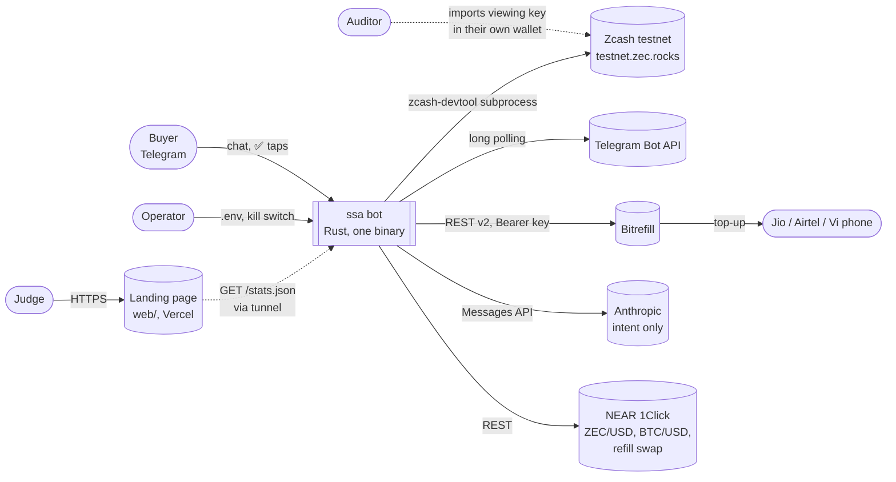
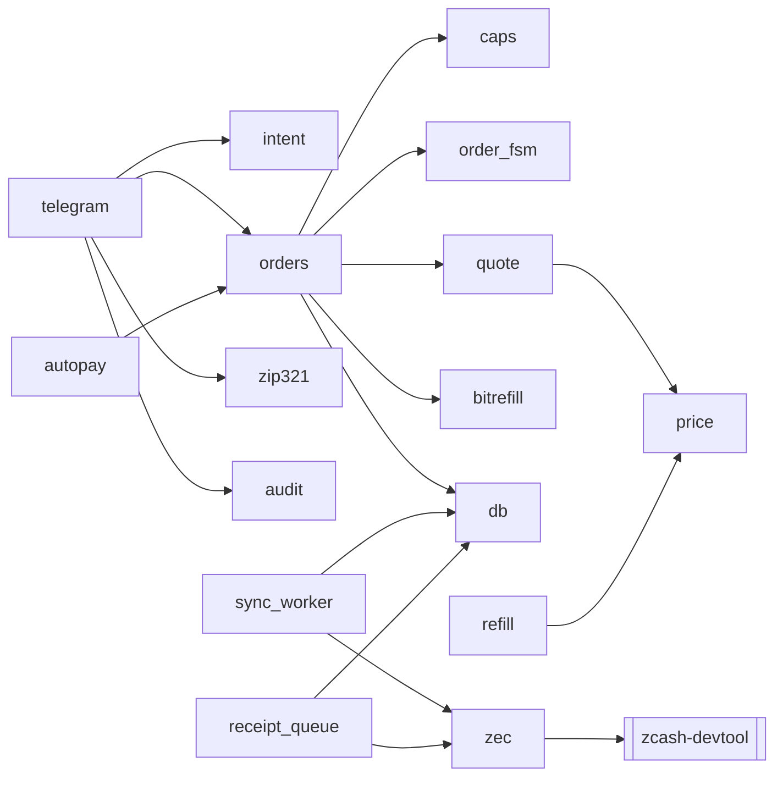
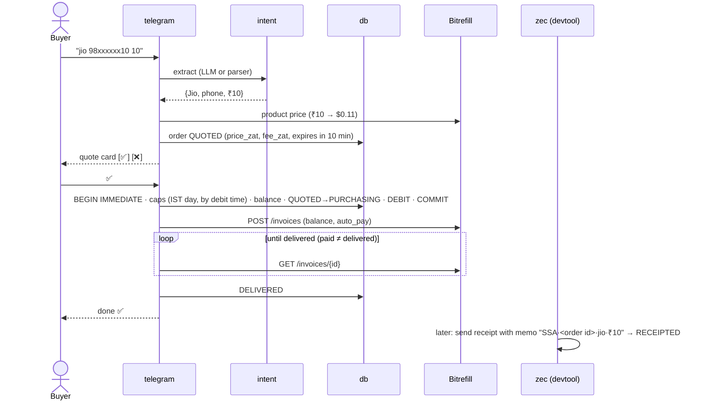
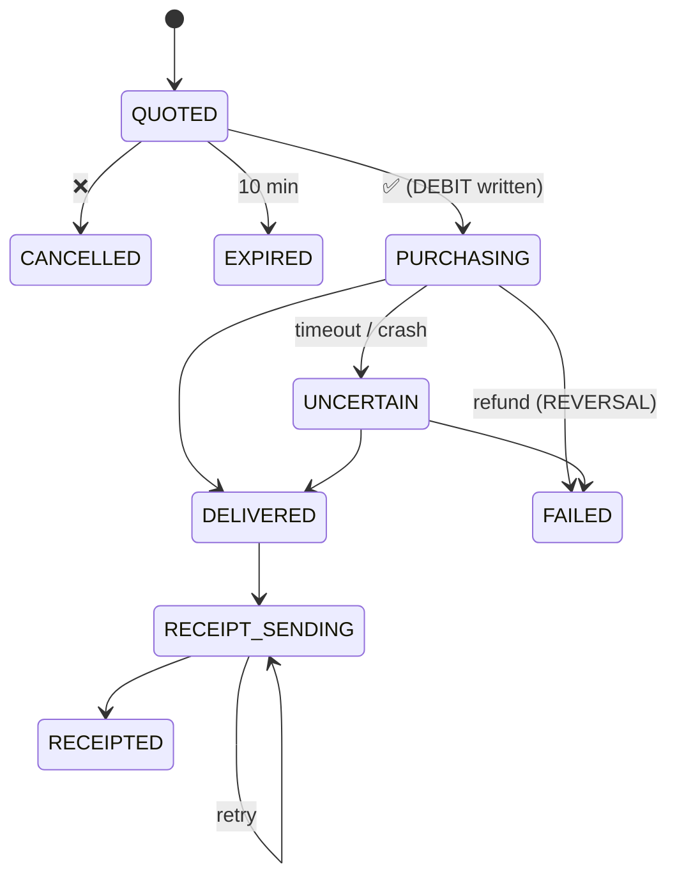
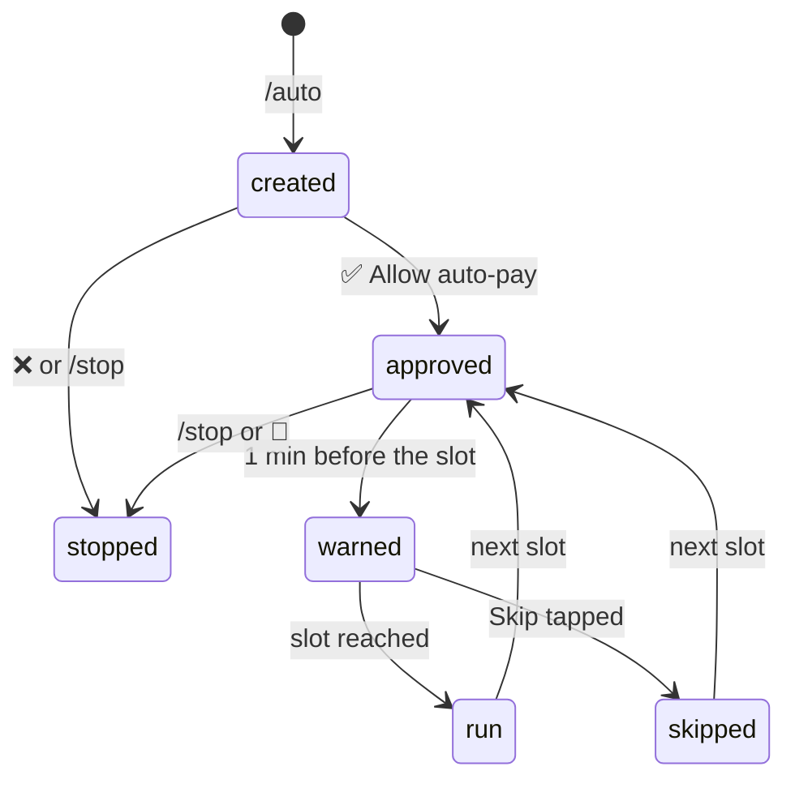

# Architecture

What we're building, how the pieces fit, and who owns what. Read this before touching `src/`.

## The product in one paragraph

A Telegram bot. You join with an invite code and get your own shielded Zcash testnet address. Deposit TAZ, then type something like *"recharge jio 98xxxxxx10 ₹10"*. The bot shows a quote in ZEC, and nothing is bought until you tap ✅. Then it buys the real top-up through Bitrefill and sends a **shielded receipt memo** that only your viewing key can read. Spending limits live in code, not in the prompt. The LLM only reads your message. It can't buy anything.

Tracks: **Privacy (Zcash)** and **Agentic Commerce (Bitrefill)**, lanes "rails and guardrails" and "private by default".

## System context

Everything runs on one laptop: the bot, SQLite, and `zcash-devtool` (Zcash's official CLI wallet) as a subprocess. Telegram is long polling, so there is no webhook. The only listener is the read-only stats endpoint (`GET /stats.json`, `127.0.0.1:8787` by default, at most 32 connections at once; the landing page reaches it through a tunnel).

## Inside the binary

| Module | Does | Pure? |
|---|---|---|
| `model` | Shared types (`Operator`) | ✅ |
| `caps` | Spending limits: ₹10–50 per order, ₹100/user/day, ₹200/day global, 30 s between buys, Jio/Airtel/Vi only | ✅ |
| `quote` | USD cents → zat, always rounded **up**, plus fee; rejects prices older than 120 s | ✅ |
| `order_fsm` | Legal order state changes (below) | ✅ |
| `zip321` | `zcash:` payment URIs for deposit QR codes | ✅ |
| `intent` | Text → `{operator, phone, ₹}`. Claude first, plain parser as fallback, every field re-validated in code | |
| `price` | ZEC/USD and BTC/USD from NEAR 1Click, cached 60 s | |
| `bitrefill` | Product prices, create invoice, poll invoice | |
| `zec` | Runs `zcash-devtool` behind **one wallet mutex** and parses its output | |
| `db` | SQLite: invites, users, ledger, orders, auto-pay rules. The ✅ step is one `BEGIN IMMEDIATE` transaction that checks the caps, checks the balance and writes the DEBIT | |
| `config` | `.env` loading. Secrets redacted in `Debug`. `SSA_PAUSED` re-read on every ✅ | |
| `autopay` | Auto-pay rules: `/auto` schedule parsing, warn-then-run loop, next-slot maths. Every run goes through `orders`, so caps and the kill switch apply | partly (`parse_rule`, `next_slot` are pure) |
| `audit` | Watch-only receipt report behind `/report` and `ssa audit`: memo parser and CSV | partly (memo parser and CSV are pure) |
| `refill` | NEAR 1Click exact-output quote and status for `ssa refill` | |
| `workers` | Deposit sync (every 20 s), receipt queue (every 15 s) and the `/stats.json` server | |
| `telegram` | Handlers (`/start`, `/balance`, `/viewkey`, `/report`, `/help`, `/auto`, `/rules`, `/stop`), invite allowlist, private-chat-only guard, owner check on buttons | |

Pure modules do no I/O and take the clock as a parameter, so they're unit-tested without mocks.

## Buying a top-up

## Order states

Every change goes through `order_fsm` plus a conditional `UPDATE … WHERE status = <expected>`, so a double tap can't buy twice. A purchase is **never retried automatically**. An unclear outcome (timeout, 5xx, transport error, or an invoice not delivered within 15 s) becomes `UNCERTAIN`. A 400, 401, 402, 403, 404 or 422 from Bitrefill means no invoice exists, so the order goes to `FAILED` and the budget is refunded. The caps are checked inside the same transaction as the DEBIT, and spend is counted from the DEBIT time, so two ✅ taps or two processes can't both squeeze under the daily limit.

## Auto-pay

The user approves a rule once (`/auto jio 9876543210 10 weekly`), and the `autopay` loop then buys on schedule. It wakes every 10 s. Each run quotes and buys through the same `orders::confirm_and_buy` path as a manual ✅, so the caps, the ledger and `SSA_PAUSED` apply every time.

- **Created.** `/auto` stores the rule unapproved and replies with a card. Nothing runs until ✅. The first run is one period away, but never less than 2 minutes, so the warning always comes first.
- **Warned.** A minute before each slot the bot messages the user with Skip and Stop buttons. Skip drops that one run and keeps the rule.
- **Run or skip.** The slot is claimed in one `BEGIN IMMEDIATE` transaction before anything is bought, so two ticks can't run it twice. The claim reads the current Skip flag, so a Skip or Stop tapped before the claim always wins. If the quote or the caps refuse, the user gets a message and the rule stays on.
- **Next slot.** The next run stays on the rule's grid. After downtime, missed slots are skipped, never bought late in a burst.
- **Stop any time.** `/rules` lists active rules and `/stop <n>` ends one. At most 3 rules per user, and the shortest period is 1 minute.

## Money and the wallet

- **One devtool wallet, one account per user.** Account 0 is the treasury. Each user gets their own account and unified address (`utest1…`), and their viewing key (UFVK) shows only their deposits and receipts.
- **The ledger decides what you can spend, not the chain.** Budget = deposits − purchases + refunds. Deposits are credited once per txid by the sync worker (every 20 s).
- **Receipts** are real shielded sends from the user's account to the treasury, carrying the order id in the memo. Before sending, the queue searches existing memos for that order id, so a crash never sends a receipt twice.
- **Integers only:** zat, cents, rupees. No floats anywhere.
- **Bitrefill is prepaid.** Bitrefill doesn't accept ZEC, and NEAR 1Click (ZEC→USDC) has no testnet. So purchases draw on a prefunded Bitrefill balance, and the ZEC side is the user's budget and receipt. We funded the live balance from shielded mainnet ZEC through NEAR 1Click (0.00519175 ZEC became 6,619 sats, and the balance read 7,689 sats; 1Click wants about $5 minimum for BTC). `ssa refill` automates the quote and prints the deposit address, but the operator still sends the ZEC by hand, and the bot doesn't credit the balance by itself.

### Facts measured on testnet today

- New shielded funds land in the **Ironwood** pool (NU7). Read `ironwood_spendable`.
- A send with one payment costs **25,000 zat** (ZIP-317), and devtool splits change into 4 notes.
- `send` prints the txid as its last line. `list-tx` shows memos per output as `Memo::Text("…")`. Its "N memos" header line is wrong, so don't use it.
- Blocks every ~25 s. A send showed up after one block.

Fixtures for all of this are in `fixtures/devtool/`, and `src/zec.rs` parses them.

## Safety rails (never cut)

✅ confirmation per order · invite allowlist · private chats only · owner check on buttons · global daily limit · `SSA_PAUSED` kill switch · secrets only in `.env` · no logging of keys, viewing keys, seeds, codes or full phone numbers.

## Hosting and CI

- **The bot** runs on the operator's machine. Nothing else hosts it.
- **The landing page** (`web/`, static) is served at https://zecshop.vercel.app. Vercel deploys it from `main` through its GitHub integration (`vercel.json` points the output directory at `web/`). The page reads live numbers from the bot's `/stats.json` through the tunnel URL in `web/config.js`; with no URL it shows "offline".
- **`.github/workflows/ci.yml`** runs `cargo fmt --check`, `cargo clippy --all-targets -- -D warnings` and `cargo test` on every push to `main` and every pull request.
- **`.github/workflows/deploy-web.yml`** also publishes `web/` to Cloudflare Workers static assets (`wrangler.jsonc`) and posts a preview link on pull requests. It needs the `CLOUDFLARE_API_TOKEN` and `CLOUDFLARE_ACCOUNT_ID` repository secrets.

The landing page has an ASCII diorama hero (MIT-licensed ascii-diorama skill and three.js) and an auto-pay node graph.

## Running it

See [README.md](README.md). Short version: `cp .env.example .env`, fill in the keys, `cargo test`, `cargo run --release`. Wallet features also need `zcash-devtool` at commit `0b3436b`.
