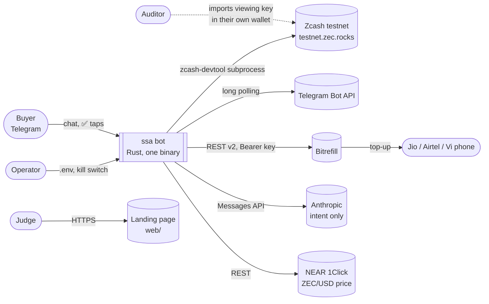
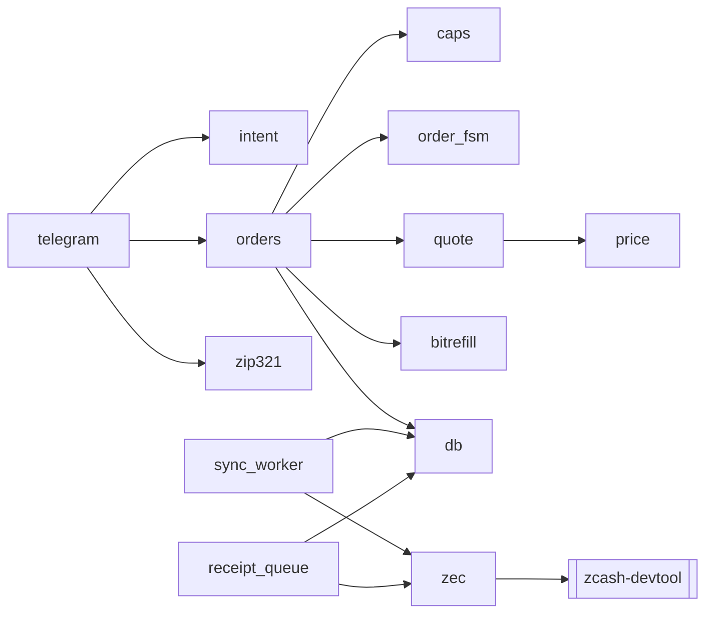
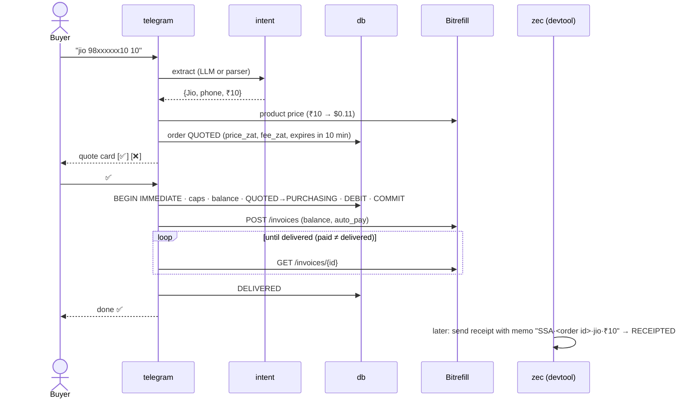
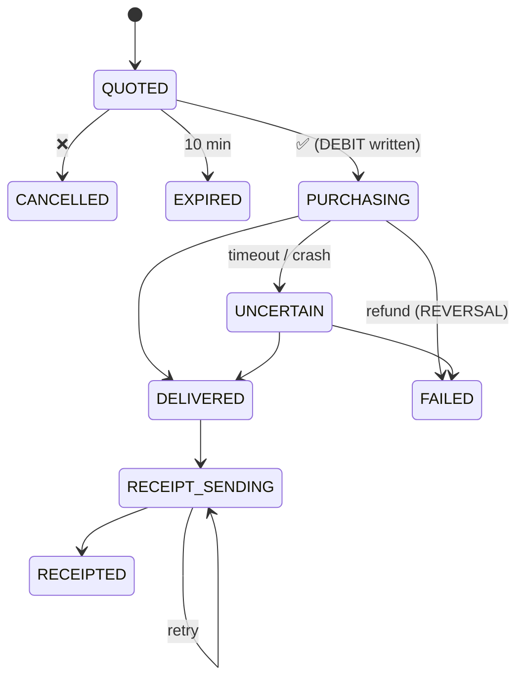

# Architecture

What we're building, how the pieces fit, and who owns what. Read this before touching `src/`.

## The product in one paragraph

A Telegram bot. You join with an invite code and get your own shielded Zcash testnet address. Deposit TAZ, then type something like *"recharge jio 98xxxxxx10 ₹10"*. The bot shows a quote in ZEC, and nothing is bought until you tap ✅. Then it buys the real top-up through Bitrefill and sends a **shielded receipt memo** that only your viewing key can read. Spending limits live in code, not in the prompt. The LLM only reads your message. It can't buy anything.

Tracks: **Privacy (Zcash)** and **Agentic Commerce (Bitrefill)**, lanes "rails and guardrails" and "private by default".

## System context

Everything runs on one laptop: the bot, SQLite, and `zcash-devtool` (Zcash's official CLI wallet) as a subprocess. There are no inbound ports.

## Inside the binary

| Module | Does | Pure? |
|---|---|---|
| `model` | Shared types (`Operator`) | ✅ |
| `caps` | Spending limits: ₹10–50 per order, ₹100/user/day, ₹200/day global, 30 s between buys, Jio/Airtel/Vi only | ✅ |
| `quote` | USD cents → zat, always rounded **up**, plus fee; rejects prices older than 120 s | ✅ |
| `order_fsm` | Legal order state changes (below) | ✅ |
| `zip321` | `zcash:` payment URIs for deposit QR codes | ✅ |
| `intent` | Text → `{operator, phone, ₹}`. Claude first, plain parser as fallback, every field re-validated in code | |
| `price` | ZEC/USD from NEAR 1Click, cached 60 s | |
| `bitrefill` | Product prices, create invoice, poll invoice | |
| `zec` | Runs `zcash-devtool` behind **one wallet mutex** and parses its output | |
| `db` | SQLite: invites, users, ledger, orders. The ✅ step is one `BEGIN IMMEDIATE` transaction | |
| `config` | `.env` loading. Secrets redacted in `Debug`. `SSA_PAUSED` re-read on every ✅ | |
| `telegram` | Handlers, invite allowlist, private-chat-only guard, owner check on buttons | |

Pure modules do no I/O and take the clock as a parameter, so they're unit-tested without mocks.

## Buying a top-up

## Order states

Every change goes through `order_fsm` plus a conditional `UPDATE … WHERE status = <expected>`, so a double tap can't buy twice. A purchase is **never retried automatically**. An unclear outcome becomes `UNCERTAIN` for a human to resolve.

## Money and the wallet

- **One devtool wallet, one account per user.** Account 0 is the treasury. Each user gets their own account and unified address (`utest1…`), and their viewing key (UFVK) shows only their deposits and receipts.
- **The ledger decides what you can spend, not the chain.** Budget = deposits − purchases + refunds. Deposits are credited once per txid by the sync worker (every 20 s).
- **Receipts** are real shielded sends from the user's account to the treasury, carrying the order id in the memo. Before sending, the queue searches existing memos for that order id, so a crash never sends a receipt twice.
- **Integers only:** zat, cents, rupees. No floats anywhere.
- **Bitrefill is prepaid.** Bitrefill doesn't accept ZEC, and NEAR 1Click (ZEC→USDC) has no testnet. So purchases draw on a prefunded Bitrefill balance, and the ZEC side is the user's budget and receipt. The mainnet path (auto-refill via 1Click) is listed as next work.

### Facts measured on testnet today

- New shielded funds land in the **Ironwood** pool (NU7). Read `ironwood_spendable`.
- A send with one payment costs **25,000 zat** (ZIP-317), and devtool splits change into 4 notes.
- `send` prints the txid as its last line. `list-tx` shows memos per output as `Memo::Text("…")`. Its "N memos" header line is wrong, so don't use it.
- Blocks every ~25 s. A send showed up after one block.

Fixtures for all of this are in `fixtures/devtool/`, and `src/zec.rs` parses them.

## Safety rails (never cut)

✅ confirmation per order · invite allowlist · private chats only · owner check on buttons · global daily limit · `SSA_PAUSED` kill switch · secrets only in `.env` · no logging of keys, viewing keys, seeds, codes or full phone numbers.

## Who owns what today

| Area | Owner |
|---|---|
| `Cargo.toml`, `main.rs`, `model.rs`, `zec.rs`, integration, this file | Vishal (zcash-3f session) |
| `caps`, `quote`, `order_fsm`, `zip321`, `config`, `db`, `bitrefill`, `price`, `intent` | agents launched by zcash-3f, reviewed before merge |
| `web/` landing page | zcash-e7 session |
| `PRIVACY.md`, `GUARDRAILS.md`, `FEEDBACK.md` | zcash-9e session |

One owner per file. If you need to change someone else's file, say so first.

## Running it

See [README.md](README.md). Short version: `cp .env.example .env`, fill in the keys, `cargo test`, `cargo run --release`. Wallet features also need `zcash-devtool` at commit `0b3436b`.
