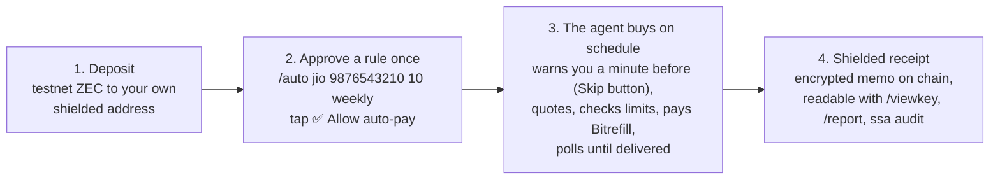

# Shielded Shopping Agent

[](https://github.com/Vishal4742/shielded-shopping-agent/actions/workflows/ci.yml)
[](LICENSE)

A Telegram bot, written in Rust, that tops up Indian phones (Jio, Airtel, Vi) on a schedule from a shielded Zcash testnet budget. You approve a rule once, for example `/auto jio 9876543210 10 weekly`, and the agent buys real top-ups through Bitrefill without another prompt. Spending limits are enforced in code, and every purchase leaves a shielded receipt memo that only your viewing key can read.

**[Landing page](https://zecshop.vercel.app)** · **[@zcashdemo_bot](https://t.me/zcashdemo_bot)** (invite only) · **Demo video:** `TODO link` (script: [DEMO.md](DEMO.md))

Built for the Free Society Hackathon, Mumbai, 4–5 Nov 2026, and entered in both the **Privacy (Zcash)** and **Agentic Commerce (Bitrefill)** tracks.

## How it works



Manual buying works too: type `jio 9876543210 10`, read the quote, tap ✅ Buy. More detail, including the order state machine: [ARCHITECTURE.md](ARCHITECTURE.md).

## Features

- **Scheduled top-ups** for Jio, Airtel and Vi: `daily`, `weekly`, `monthly`, `every 2m`, `every 3 hours`. At most 3 rules per user.
- **Code-enforced limits:** ₹10–₹50 per order, ₹100 per user per day, ₹200 per day for the whole bot, 30 s between buys, and a kill switch. The LLM only reads the message; it can't buy anything.
- **Shielded by default:** one unified address per user, encrypted receipt memos, and a viewing key you can hand to an auditor.
- **Viewing-key report:** `/report` and `ssa audit` rebuild your purchase list from the key alone, in a throwaway watch-only wallet.
- **Refill from ZEC:** `ssa refill` quotes a NEAR Intents 1Click swap to top up the Bitrefill balance from shielded ZEC.
- **Optional Tor** for wallet traffic (`SSA_TOR=1`).

## Which part is for which track

| Track | What counts |
|---|---|
| **Privacy (Zcash)** | Shielded deposits (unified addresses, Ironwood pool). Encrypted receipt memos for each purchase. Viewing-key disclosure: `/viewkey`, `/report` (a CSV of your purchases rebuilt from the viewing key alone) and `ssa audit` (the same for an outside auditor). Optional Tor for wallet traffic with `SSA_TOR=1`. A trust note on who sees what: [PRIVACY.md](PRIVACY.md). |
| **Agentic Commerce (Bitrefill)** | Bitrefill REST API v2: product lookup, invoices, invoice polling. Agent-initiated purchases on a schedule, with no prompt from the user at run time. Code-enforced guardrails: [GUARDRAILS.md](GUARDRAILS.md). `ssa refill` tops up the Bitrefill balance from shielded mainnet ZEC through NEAR Intents 1Click. |

Bitrefill lanes we're going for:

- **Lane 1, Rails and guardrails.** Spend caps, a kill switch and a confirm step live in code, not in a prompt.
- **Lane 3, No prompt required.** Auto-pay rules run on a timer without anyone typing a request.
- **Lane 5, Private by default.** Funds and receipts are shielded Zcash. Bitrefill never sees the user's address or Telegram account. The Bitrefill balance itself can be refilled from shielded ZEC with `ssa refill`, at the cost of one deshielded transfer (see [PRIVACY.md](PRIVACY.md)).

## Quick start

You need Rust 1.99 (what we built with; the 2024 edition needs at least 1.85), git, a Telegram bot token from @BotFather, a Bitrefill API key and an Anthropic API key.

```sh
# 1. Build the Zcash wallet tool at the commit we tested
git clone https://github.com/zcash/zcash-devtool tools/zcash-devtool
(cd tools/zcash-devtool && git checkout 0b3436b && cargo build --release)

# 2. Create the testnet wallet. Account 0 is the treasury that receives receipts.
D=tools/zcash-devtool/target/release/zcash-devtool
$D wallet -w tools/wallets/ssa init --name treasury -i tools/wallets/identity.age -n test
$D wallet -w tools/wallets/ssa list-accounts          # note the treasury account's UUID
$D wallet -w tools/wallets/ssa list-addresses <UUID>  # copy its unified address (utest1…)

# 3. Configure
cp .env.example .env      # fill in TELEGRAM_BOT_TOKEN, BITREFILL_API_KEY, ANTHROPIC_API_KEY, SSA_TREASURY_UA

# 4. Create an invite code (DEMO, 10 uses), then start the bot
cargo run --release -- invite DEMO 10
cargo run --release
```

`.env.example` defaults to `BITREFILL_DRY_RUN=1`, which creates no invoices and buys nothing. Set it to `0` for real purchases and restart. Bitrefill limits an account to 5 phone top-ups a day.

`SSA_TOR=0` is the default too. Set `SSA_TOR=1` to send every wallet call that talks to the light-wallet server (sync, receipt send, account creation) through Tor, so the server sees a Tor exit instead of your IP. It is slower: about 11 s a call instead of 2 s on testnet. It covers wallet traffic only, not Telegram, Bitrefill, Anthropic or NEAR, and not `/report` or `ssa audit`. Restart the bot after changing it.

Then in Telegram:

1. Send `/start DEMO`. You get a shielded address and a QR code.
2. Send testnet ZEC to it from a faucet. The bot checks for deposits every 20 s. `/balance` shows what you can spend.
3. Send `jio 9876543210 10`, read the quote and tap ✅ Buy.
4. Send `/auto jio 9876543210 10 every 2m` and tap ✅ Allow auto-pay. The first run comes 2 minutes later, preceded by a warning with Skip and Stop buttons.
5. `/rules` lists your rules, `/stop 1` ends rule 1, `/viewkey` shows your viewing key.
6. `/report` builds a throwaway watch-only wallet from your viewing key alone, syncs it (about 30 s) and sends back `ssa-receipts.csv` with columns `txid,mined_height,order_ref,operator,inr,zat`, one line per purchase receipt. The wallet can't spend and is deleted afterwards. On testnet it lists your receipt and none of the treasury's transactions. A receipt needs a block or two to be mined before it shows up.

To pause all buying, set `SSA_PAUSED=1` in `.env`. It is read again on every purchase, so no restart is needed.

### Audit a viewing key: `ssa audit`

For an outside auditor who holds only a user's viewing key (the `uviewtest1…` string from `/viewkey`) and that account's birthday height:

```sh
SSA_AUDIT_UFVK='uviewtest1…' cargo run --release -- audit <BIRTHDAY_HEIGHT> > receipts.csv
```

It prints the same CSV as `/report` to stdout. The first sync scans from the birthday, so it can take from half a minute to a few minutes. Things to know:

- The key goes in the `SSA_AUDIT_UFVK` environment variable, never in a file. zcash-devtool only accepts it as a command-line argument, so it is visible in `ps` on that machine while `init-fvk` runs. Use a machine you trust.
- The command reads the bot's config first, so `.env` must exist with non-empty `TELEGRAM_BOT_TOKEN`, `BITREFILL_API_KEY`, `ANTHROPIC_API_KEY` and `SSA_TREASURY_UA` (placeholders are fine) and `SSA_DEVTOOL` must point at the devtool binary.
- Memos aren't authenticated, so a memo in the `SSA·…` format sent to the user by someone else would also be listed. See [PRIVACY.md](PRIVACY.md).

### Refill the Bitrefill balance from ZEC: `ssa refill`

Bitrefill doesn't take ZEC. `ssa refill` asks NEAR Intents 1Click for an exact-output swap, ZEC to USDC on Base (or BTC), paid to your Bitrefill deposit address, and prints where to send the ZEC. Like `ssa audit`, it loads the bot's `.env` first.

```sh
# 1. See the price first. --dry reserves no deposit address.
cargo run --release -- refill 5 usdc-base 0xYOUR_BITREFILL_DEPOSIT_ADDR t1YourZcashRefundAddr --dry

# 2. Reserve a deposit address (valid 30 min) and get the exact amount and a zcash: payment URI
cargo run --release -- refill 5 usdc-base 0xYOUR_BITREFILL_DEPOSIT_ADDR t1YourZcashRefundAddr

# 3. Send exactly that ZEC from your own wallet, then track the swap
cargo run --release -- refill status <DEPOSIT_ADDR_FROM_STEP_2>
```

Arguments: `<USD>` is whole dollars or dollars and cents, the destination is `usdc-base` or `btc`, the deposit address is the one Bitrefill's "Add funds" page shows for that asset, and the refund address must start with `t` or `u`. Status values: `PendingDeposit`, `KnownDepositTx`, `IncompleteDeposit`, `Processing`, `Success`, `Refunded`, `Failed`. Status errors until step 2 has created a deposit address.

This is mainnet only, since 1Click has no testnet. The command doesn't send the ZEC for you. 1Click takes ZEC at a transparent address, so that one transfer is deshielded: the amount and the Bitrefill address are visible to 1Click and the chain. The bot's demo purchases are not affected, and testnet ZEC never goes through this path.

We used it for the live balance: 0.00519175 ZEC from a shielded wallet became 6,619 sats of BTC in the Bitrefill account, which then read 7,689 sats. 1Click wanted about $5 minimum for BTC, so we funded the balance once instead of paying each ₹10 order.

## Bitrefill touchpoints

We call the Bitrefill **REST API v2** directly from one module (`src/bitrefill.rs`) and use three endpoints: `GET /products/{slug}` for the package list and price, `POST /invoices` with `payment_method: "balance"` and `auto_pay: true` to buy, and `GET /invoices/{id}` polled until the status is delivered (paid is not the same as delivered). We don't use the MCP server or the CLI. Prices on our account come back in BTC satoshis, so we convert them to USD cents with NEAR 1Click's BTC/USD price and to zat with its ZEC/USD price. **Built by us:** the Bitrefill client and response parsers, the quote maths, the order state machine, the caps, the auto-pay scheduler, the ledger, the receipt queue, the viewing-key report and the `ssa refill` command. **Reused:** the Bitrefill API itself, `zcash-devtool` for the wallet, NEAR 1Click for prices and for the ZEC refill swap, Telegram and Anthropic Claude (to read the user's message). Notes on what confused us: [FEEDBACK.md](FEEDBACK.md).

## Guardrails

Enforced in code on every purchase, manual or scheduled. Full list: [GUARDRAILS.md](GUARDRAILS.md).

- Jio, Airtel and Vi only. ₹10–₹50 per order. 30 s between buys.
- ₹100 per user per day, ₹200 per day for the whole bot. Nobody can approve more. The limits are checked in the same database transaction that debits the budget, and spend counts from the moment of the ✅.
- Auto-pay: one approval per rule, at most 3 rules per user, a warning with Skip a minute before each run (a Skip tapped before the run starts always wins), stop any time. Missed runs are skipped, not bought later in a batch.
- Kill switch: `SSA_PAUSED=1`. The LLM only reads the message. It can't buy anything.

## Privacy and trust

Deposits and receipts are shielded, and Bitrefill sees our account, not yours. We run a custodial wallet, so privacy here is against the public and the merchant, not against us. Telegram, Anthropic and the lightwalletd server each see something too (with `SSA_TOR=1` the server sees a Tor exit, not our IP). A viewing key shows its whole account history to whoever holds it, and `/report` can list a forged `SSA·…` memo because memos aren't authenticated. Refilling the Bitrefill balance with `ssa refill` deshields one transfer. The full table and our fix list are in [PRIVACY.md](PRIVACY.md).

## Invoice ID of a real purchase

`f626ee23-12dd-4e6c-aa12-94d2ebdcc1b5` (₹10 Jio talktime, 4 Nov 18:33 IST, Bitrefill status `all_delivered`, paid from store credit). A second agent purchase, `2a9091e4-baab-423b-a447-2f93953238e7`, followed at 18:34. Both orders then got their shielded receipt memo on Zcash testnet (txids `b7c77ea0…c425f` and `837a1bce…39a04`).

## Limitations

- If Bitrefill errors out while creating the invoice (5xx or timeout), there is no invoice id and the API has no reference field, so the order stays `UNCERTAIN` and debited until the operator checks the Bitrefill dashboard. We never retry a purchase that might have gone through. A clear rejection (400, 401, 402, 403, 404, 422) means no invoice exists, so the order fails and the budget is refunded.
- **Custodial, shared wallet.** One devtool wallet with one account per user. The operator holds the spending keys.
- **Prepaid Bitrefill balance.** Bitrefill doesn't take ZEC, and NEAR 1Click has no testnet, so purchases draw on a balance we funded in advance. The user's ZEC is a budget in our ledger and the receipt, not the payment Bitrefill receives. `ssa refill` can fund that balance from mainnet ZEC, but it only prints the quote and deposit address; the operator sends the ZEC by hand, and the bot doesn't credit anything automatically.
- **The LLM sees chat text.** Messages go to Anthropic to extract operator, phone and amount. A plain parser is the fallback.
- **Testnet only.** TAZ has no value.

## Project layout

```text
src/
  main.rs        starts the bot and workers; subcommands: invite, audit, refill
  telegram.rs    command handlers, invite allowlist, private-chat guard, button owner check
  orders.rs      quote, confirm-and-buy, refund and crash recovery
  autopay.rs     auto-pay rules, schedule parsing, the warn-then-run loop
  caps.rs        spending limits (pure)
  quote.rs       price in zat, rounded up, with fee (pure)
  order_fsm.rs   legal order state changes (pure)
  zip321.rs      zcash: payment URIs for deposit QR codes (pure)
  model.rs       shared types (pure)
  intent.rs      text to operator, phone and amount; Claude first, parser fallback
  price.rs       ZEC/USD and BTC/USD from NEAR 1Click
  bitrefill.rs   Bitrefill REST client
  refill.rs      NEAR 1Click quote and status client for ssa refill
  zec.rs         runs zcash-devtool behind one wallet mutex and parses its output
  audit.rs       watch-only report behind /report and ssa audit: memo parser and CSV
  db.rs          SQLite for invites, users, ledger, orders and rules (migrations/)
  workers.rs     deposit sync, receipt queue and the public /stats.json server
  config.rs      .env loading
fixtures/        saved API and devtool responses the tests run against
web/             static landing page
.github/workflows/  ci.yml (fmt, clippy, tests), deploy-web.yml (Cloudflare)
```

Money is integers only (zat, paise, cents). The pure modules do no I/O and take the clock as a parameter. More detail: [ARCHITECTURE.md](ARCHITECTURE.md).

## Testing

```sh
cargo test                                         # 162 tests, about 15 s
cargo fmt --check && cargo clippy --all-targets -- -D warnings
cargo llvm-cov --summary-only                      # needs cargo-llvm-cov
```

Line coverage is 76% overall. The pure modules (`caps`, `quote`, `order_fsm`, `zip321`, `model`) sit at 98–100%; `telegram.rs` and `main.rs` are the least covered. Network code is tested against saved responses in `fixtures/` and a mock Bitrefill, so `cargo test` needs no keys and makes no network calls. CI runs the format check, clippy and the tests on every push to `main` and every pull request.

## Deployment

- **Landing page:** static files in `web/`, served at https://zecshop.vercel.app. Vercel deploys from `main` through its GitHub integration (`vercel.json`). `deploy-web.yml` also publishes the same folder to Cloudflare Workers (`wrangler.jsonc`) and posts a preview link on pull requests.
- **The bot** runs on the operator's machine (`cargo run --release`) with `zcash-devtool` as a subprocess and SQLite on disk. Its only listener is the read-only `/stats.json` endpoint the landing page reads through a tunnel.

## Security

Report problems privately, not in a public issue. See [SECURITY.md](SECURITY.md).

## Contributing

Pull requests are welcome. See [CONTRIBUTING.md](CONTRIBUTING.md) and the [code of conduct](CODE_OF_CONDUCT.md). In short: CI must be green, money is integers, and limits stay in code.

Hackathon rule: project source code was written on 4 Nov 2026, after the 11:00 IST start.

## License

[MIT](LICENSE).

## Acknowledgements

- [zcash-devtool](https://github.com/zcash/zcash-devtool): the wallet, run as a subprocess.
- [Bitrefill](https://www.bitrefill.com): the top-up API.
- [NEAR Intents 1Click](https://docs.near-intents.org): prices and the ZEC refill swap.
