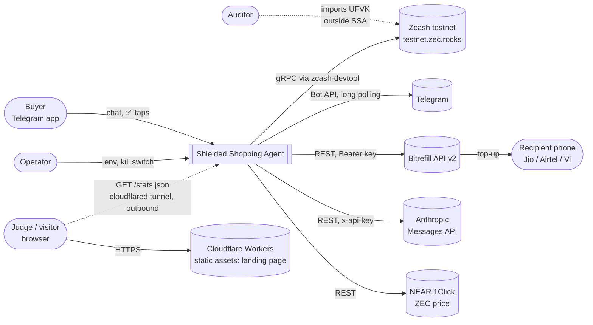
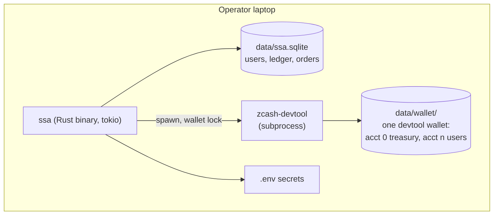
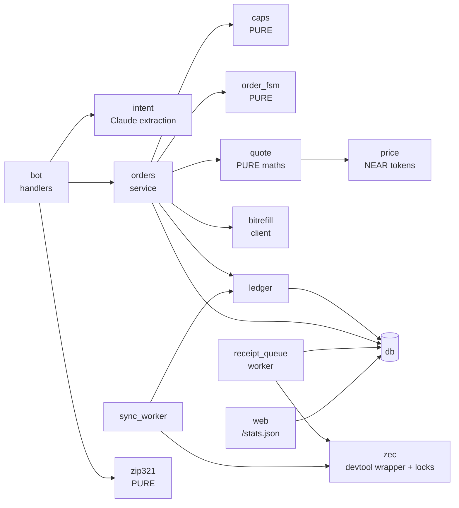

# 04 — Software Architecture Document

Structure: arc42 (condensed) with C4 views · v1.0 · 30 Oct 2026 · Requirements: [03-srs.md](03-srs.md)

## 1. Goals and quality priorities

| Priority | Quality goal | Scenario |
|---|---|---|
| 1 | **Safety of money** | A prompt-injected or double-tapped request never buys twice or past the limits (NFR-4, NFR-5) |
| 2 | **Privacy** | Only the user's UFVK reveals their deposits and receipts (FR-10, FR-11) |
| 3 | **Demo reliability** | ✅ → top-up in ≤ 15 s; failures are explained (NFR-1, NFR-8) |
| 4 | **Buildability** | Fits 12.5 h with 1–2 people (charter constraint) |

## 2. Constraints
Rust only (C1) · no WebZjs/Snap/Zallet (C2) · testnet ZEC with real Bitrefill (C4) · one laptop, no inbound ports (NFR-10).

## 3. Context: C4 level 1



## 4. Containers: C4 level 2



| Container | Tech | Responsibility |
|---|---|---|
| `ssa` binary | Rust, tokio, teloxide, reqwest, rusqlite | All application logic |
| SQLite DB | rusqlite, single connection behind a mutex | Users, ledger, orders, invites |
| Wallet dir | zcash-devtool's own SQLite + encrypted seed (age) | One wallet; account 0 treasury, one account per user |
| zcash-devtool | ECC CLI (Rust), release build | Sync, balance, address, send with memo, UFVK |

## 5. Components: C4 level 3 (inside `ssa`)



| Component | Responsibility | Depends on |
|---|---|---|
| `bot` | Telegram routing, private-chat guard, allowlist, rendering | intent, orders, ledger, zip321 |
| `intent` | One Claude call → `{operator, phone, amount_inr}` or a question | Anthropic API |
| `orders` | Quote create, ✅ transaction, purchase, polling, restart recovery | caps, fsm, quote, bitrefill, ledger, db |
| `caps` (pure) | Decide allow/deny for BR-1..BR-5 | — |
| `order_fsm` (pure) | Legal state transitions | — |
| `quote` (pure) | USD → zat with ceil rounding + ZIP-317 fee | — |
| `zip321` (pure) | Build `zcash:` URIs | — |
| `ledger` | Credits (deposits) and debits (orders); available balance | db |
| `zec` | devtool subprocess wrapper; one wallet `tokio::Mutex`; output parsing | devtool |
| `sync_worker` | Sequential sync of wallets; records new deposits | zec, ledger |
| `receipt_queue` | Sends receipt transfers; retries until spendable; idempotent | zec, db |
| `price` | ZEC/USD from NEAR 1Click, cached 60 s | NEAR API |
| `bitrefill` | Typed client for product, invoice, order | Bitrefill API |
| `web` | axum route `GET /stats.json` on 127.0.0.1; aggregates cached 10 s (FR-16) | db (same spend query as `caps`) |

## 6. Runtime view (key scenarios)

### 6.1 Purchase (UC-2)
```mermaid
sequenceDiagram
  actor U as Buyer
  participant B as bot
  participant I as intent (Claude)
  participant O as orders
  participant D as db
  participant R as Bitrefill
  participant Q as receipt_queue
  U->>B: "Recharge Jio 98xxxxxx10 ₹10"
  B->>I: extract intent
  I-->>B: {Jio, 98xxxxxx10, 10}
  B->>O: create_quote
  O->>R: GET product (Jio, ₹10 package USD price)
  O->>D: INSERT order QUOTED (zat = ceil, + fee)
  B-->>U: Quote card [✅][❌]
  U->>B: ✅
  B->>O: confirm(order, user)
  O->>D: BEGIN IMMEDIATE; checks; UPDATE … SET PURCHASING WHERE status='QUOTED'; COMMIT
  O->>R: POST /invoices (balance, auto_pay, ref=order id)
  O->>D: save invoice id
  loop until complete (≤ 15 s)
    O->>R: GET /invoices/{id}
  end
  O->>D: DELIVERED
  B-->>U: Done ✅
  O->>Q: enqueue receipt(order)
  Q->>Q: (async) devtool send with memo → RECEIPTED
```

### 6.2 Deposit detection
`sync_worker` loops over wallets one at a time: acquire the lock → `sync` → `list-tx` → for each new
received txid with ≥ 1 confirmation, insert a ledger credit (`UNIQUE(txid)`) → release.

### 6.3 Restart recovery
On boot: orders in PURCHASING with an invoice id → resume polling. Orders in PURCHASING without one →
look up by reference if Q5 allows, else UNCERTAIN. Orders in RECEIPT_SENDING → search the wallet's
`list-tx` memos for the order id before re-sending.

## 7. Deployment view

| Node | Runs | Notes |
|---|---|---|
| Operator MacBook | `ssa` binary, zcash-devtool, SQLite files, `cloudflared` (demo only) | Long polling; no inbound ports; stats leave through the outbound tunnel |
| Cloudflare Workers (static assets) | `web/` static files via `npx wrangler deploy` | Always up, even with the laptop off (FR-15) |
| Phone hotspot | Backup uplink | Switch if venue Wi-Fi fails |
| Second laptop / phone | Watch-only wallet for the UFVK demo | Zingo or devtool |

## 8. Crosscutting concepts

- **Concurrency:** one SQLite connection behind `tokio::Mutex`; one `tokio::Mutex` for the wallet dir wraps every devtool call (sync, send, address), so they never overlap.
- **Idempotency:** order id (UUID v4) is the key for the purchase reference and the receipt memo. Ledger credits are unique per txid.
- **Money maths:** integers only (zat, paise, cents); always round the user's cost up.
- **Time:** all limits use IST days; timestamps stored as UTC epoch seconds.
- **Errors:** typed errors per component (`thiserror`); messages to users come from one catalogue (05 §9).
- **Logging:** `tracing`, with phone numbers masked (`98xxxx…10`); codes, keys and seeds never logged.
- **Config:** `.env` read once at boot, apart from `SSA_PAUSED`, which is read at every ✅.

## 9. Architecture decisions
See [06-adrs.md](06-adrs.md): ADR-001 … ADR-011.

## 10. Quality risks and technical debt
See [10-risk-register.md](10-risk-register.md). Known debt, marked `ponytail:` in code: subprocess
wallet layer (one call per op), one shared wallet lock, custodial keys.
